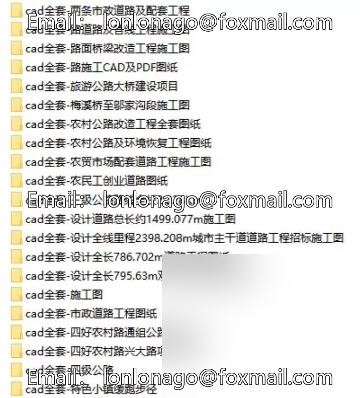
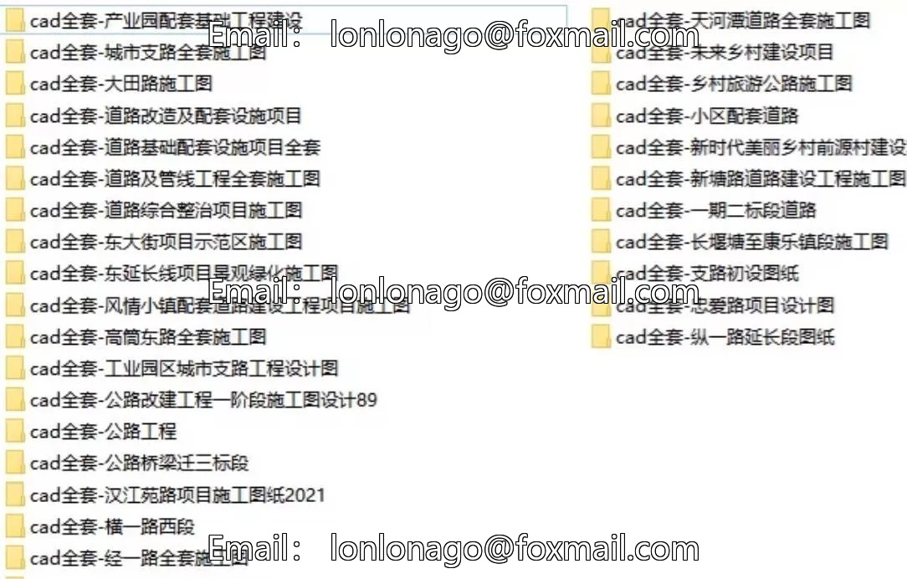
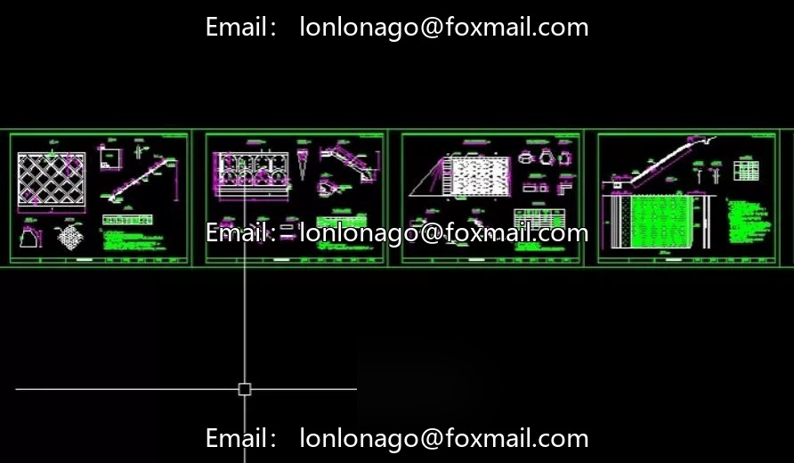
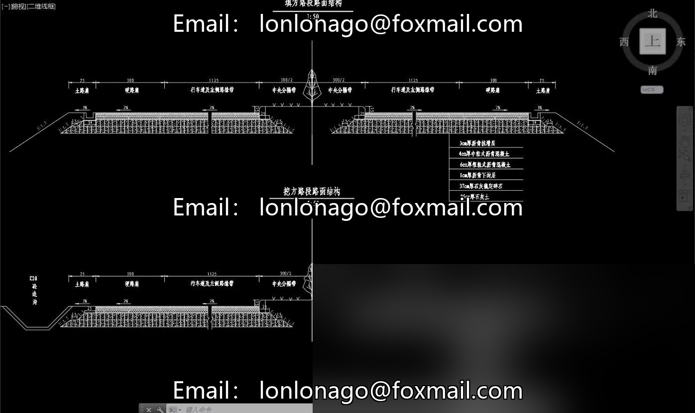
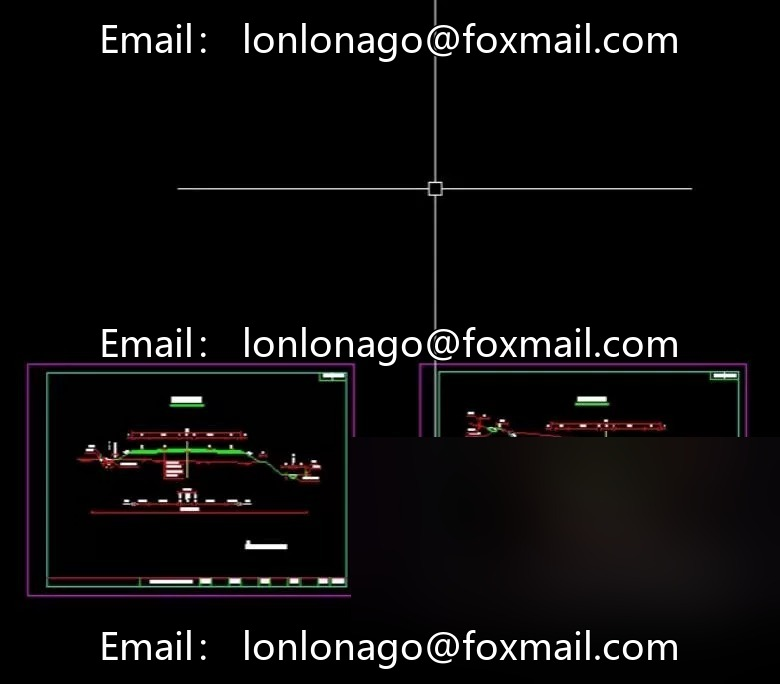
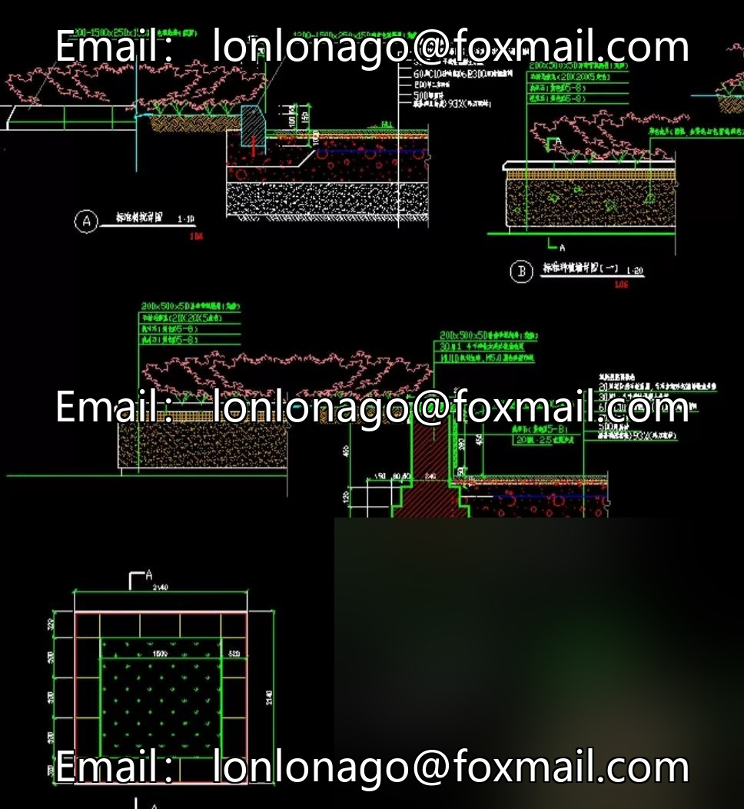

# Construction drawing CAD project drawing files, including small traffic roads, urban branch roads, and rural roads

## Body

Construction drawing cad engineering project drawing files, including the construction drawings of small traffic roads such as pedestrian roads, urban branch roads, rural roads, community supporting roads, four good rural road groups, thematic town supporting roads, and agricultural market supporting roads; cad files containing road, drainage, lighting, power, landscape and other professional content, all in full.

web-based shipment, can be directly photographed and shipped.

The project drawings cover small traffic roads, urban branch roads, rural roads, community road works and specialized works including road, drainage, lighting, power and landscape.

<!-- AI_ENRICHED -->

## Images

## Payment

Here is a pay link on Stripe ( https://buy.stripe.com/3cs8yP7sY87d0vu9AB ). Please contact me lonlonago@foxmail.com after funding $89, and I will send you a complete data files , thank you!

